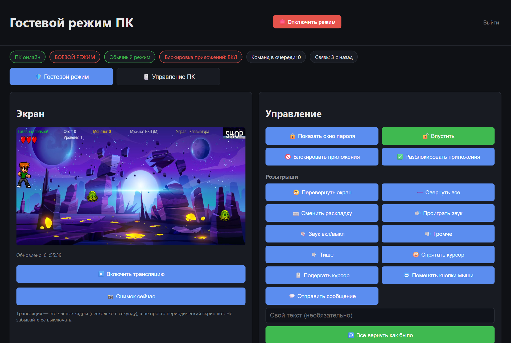
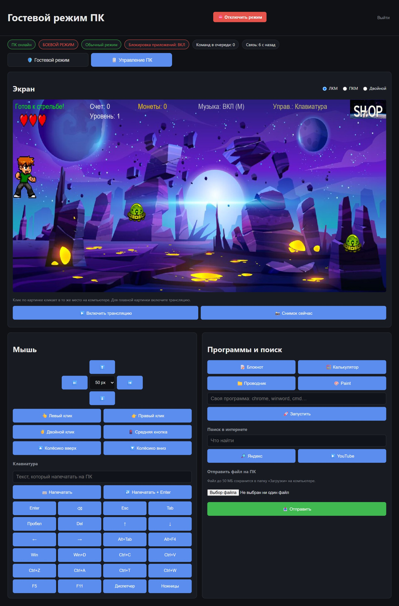

# 🛡️ Гостевой режим ПК

Система для защиты Windows-компьютера, пока за ним сидят гости. На ПК работает агент, а хозяин управляет им из веб-панели с телефона или другого компьютера: видит экран в реальном времени, показывает окно пароля, блокирует лишние программы и при желании управляет мышью и клавиатурой.




| Управление ПК | С телефона |
|---|---|
|  |  |

## Возможности

- **Окно пароля** на весь экран: гость вводит пароль, иначе через заданное время ПК выключается.
- **Блокировка программ** по белому списку: всё, что не разрешено, закрывается.
- **Трансляция экрана** (MJPEG) и снимки по кнопке.
- **Вкладка «Управление ПК»:** клик прямо по трансляции, движение курсора, ЛКМ/ПКМ/двойной клик, колёсико, ввод текста (в том числе русского), 24 горячие клавиши, запуск программ, поиск в Яндексе и на YouTube, отправка файлов на ПК.
- **Обратимые розыгрыши:** перевернуть экран, сменить раскладку, спрятать курсор, всплывающее сообщение и другие, всё отменяется одной кнопкой.
- **Аварийный выход:** кнопка в панели или файл-флаг на диске сразу снимает все блокировки.
- **Тестовый режим `DRY_RUN`:** агент только пишет в лог, что сделал бы. Включается исключительно на самом ПК, с сайта его не поменять.
- **Безопасность:** вход по паролю с блокировкой после 5 ошибок, отдельный токен для агента, защита от CSRF, проверка всех входных данных.
- **Панель как приложение на телефоне** (PWA).

## Как это работает

```
 телефон / браузер ──HTTP──► сервер (FastAPI)  ◄──long-poll──  агент на ПК (Windows)
   панель, кнопки            очередь команд,                    выполняет команды,
                             статус, скриншоты                  шлёт статус и экран
```

Агент сам ходит к серверу (long-poll), поэтому на ПК не нужно открывать порты: команды доходят почти мгновенно, даже если ПК за NAT.

## Структура проекта

Состоит из двух независимых частей:

```
guest_mode/
├── README.md                  — этот файл
├── docs/                      — скриншоты для README
├── .gitignore
│
├── server/                    # веб-панель управления (FastAPI), ставится на ваш сервер
│   ├── main.py                  — точка входа, все HTTP/API-маршруты
│   ├── config.py                 — настройки из server/.env
│   ├── auth.py                    — вход по паролю, проверка токена агента
│   ├── state.py                    — статус агента, очередь команд, лог событий, скриншот
│   ├── install_task.ps1             — автозапуск сервера (Планировщик заданий)
│   ├── uninstall_task.ps1            — удаление автозапуска
│   ├── templates/                     — HTML-страницы (Jinja2)
│   │   ├── login.html
│   │   └── dashboard.html
│   ├── static/                         — CSS и JS панели
│   │   ├── style.css
│   │   ├── dashboard.js
│   │   ├── names.js                      — русские названия программ
│   │   ├── manifest.webmanifest          — чтобы панель ставилась на телефон как приложение
│   │   └── icon.svg
│   ├── requirements.txt
│   └── .env.example
│
├── agent/                     # агент на вашем ПК (Windows 11)
│   ├── agent.py                  — главный цикл: опрос команд, отчётность
│   ├── config.py                  — настройки из agent/.env, включая DRY_RUN
│   ├── logger_setup.py             — логирование в файл + консоль
│   ├── reporter.py                  — отправка статуса/скриншота/лога на сервер
│   ├── password_window.py            — окно второго пароля (tkinter)
│   ├── app_blocker.py                 — блокировка приложений по белому списку (psutil)
│   ├── pranks.py                       — обратимые розыгрыши
│   ├── pc_control.py                    — блокировка сеанса, открыть ссылку
│   ├── remote_control.py                — мышь, клавиатура, программы, поиск (WinAPI SendInput)
│   ├── install_task.ps1                  — установка автозапуска (Планировщик заданий)
│   ├── uninstall_task.ps1                 — удаление автозапуска
│   ├── requirements.txt
│   └── .env.example
│
└── tests/                     # автотесты сервера и агента (DRY_RUN)
    ├── conftest.py
    ├── test_server.py
    └── test_agent.py
```

## Как это работает

1. **Сервер** — веб-сайт с паролем, который видит статус ПК, последний
   скриншот, список процессов и лог событий, и ставит команды в очередь
   (например, «показать окно пароля» или «перевернуть экран»).
2. **Агент** на ПК каждые несколько секунд спрашивает у сервера, есть ли
   новая команда, выполняет её, и раз в 5–15 секунд отправляет статус,
   список процессов и скриншот.
3. Агент и сервер общаются по HTTP с авторизацией секретным токеном
   (заголовок `X-Agent-Token`) — это не то же самое, что пароль входа
   на сайт.

## ⚠️ Тестовый режим (DRY_RUN) — прочитайте перед первым запуском

В `agent/.env` есть параметр `DRY_RUN`:

- **`DRY_RUN=true` (по умолчанию)** — ни одно опасное действие
  (выключение ПК, закрытие программ, переворот экрана и т.п.) не
  выполняется по-настоящему. Вместо этого в лог и на сайт пишется
  строка вида `[DRY_RUN] выключил бы ПК`. Окно пароля в этом режиме —
  обычное окно (не на весь экран), закрывается крестиком, а по истечении
  таймера вместо выключения просто пишет в лог.
- **`DRY_RUN=false`** — боевой режим, всё выполняется по-настоящему.

**`DRY_RUN` переключается только вручную, в файле `agent/.env` на самом
ПК.** С сайта управления изменить его нельзя — это сделано специально,
чтобы никто не включил боевой режим удалённо.

## Аварийный выход

Два независимых способа немедленно снять все блокировки:

1. **Кнопка «⛔ Отключить режим»** в панели управления на сайте.
2. **Файл-флаг** на ПК, путь задаётся в `agent/.env` (`EMERGENCY_FLAG`,
   по умолчанию `C:\guest_mode_off.flag`). Как только агент видит этот
   файл — он сразу снимает окно пароля, выключает блокировку приложений
   и отменяет розыгрыши, и не включает их заново, пока файл существует.
   Создать его можно вручную, в т.ч. с флешки или по сети (например,
   через `New-Item C:\guest_mode_off.flag`), даже если сайт недоступен.

## Порядок работы (обязательно по шагам)

1. **Установка и настройка** (раздел ниже) — поднимаете сервер и агента
   локально, `DRY_RUN=true`.
2. **Тесты в DRY_RUN** — проходите чек-лист в конце этого файла. Убеждаетесь,
   что окно пароля появляется и закрывается, блокировка приложений,
   розыгрыши и кнопки на сайте работают, и везде в логе видно `[DRY_RUN]`.
3. **Пробный боевой запуск на 5 минут при вас** — ставите `DRY_RUN=false`
   в `agent/.env`, перезапускаете агент, проверяете каждую функцию ещё раз
   вручную (сами сидите за ПК), держите окно диспетчера задач открытым
   на случай, если что-то пойдёт не так. **Не уходите от ПК на этом шаге.**
4. **И только потом** — автозапуск через `install_task.ps1`.

## Установка

### 1. Сервер (на вашем сервере / отдельной машине)

```powershell
cd server
python -m venv .venv
.venv\Scripts\activate
pip install -r requirements.txt
copy .env.example .env
```

Откройте `.env` и заполните:
- `ADMIN_PASSWORD` — пароль входа в панель, открытым текстом, просто
  впишите (это домашняя панель на своём ПК — хэш с солью тут ничего
  не защищает, кроме как от самого себя, если забудете пароль);
- `AGENT_TOKEN` — длинная случайная строка (придумайте сами, этот же
  токен потом впишете в `agent/.env`);
- `SESSION_SECRET` — ещё одна случайная строка
  (`python -c "import secrets; print(secrets.token_hex(32))"`).

Запуск сервера:

```powershell
python main.py
```

Сайт откроется на `http://<адрес_сервера>:8000` (или на `127.0.0.1:8000`,
если тестируете локально).

### 2. Агент (на защищаемом ПК с Windows 11)

```powershell
cd agent
python -m venv .venv
.venv\Scripts\activate
pip install -r requirements.txt
copy .env.example .env
```

Откройте `.env` и заполните:
- `GUEST_PASSWORD` — пароль окна блокировки, открытым текстом, просто
  впишите;
- `SERVER_URL` — адрес вашего сервера (например, `http://192.168.1.10:8000`);
- `AGENT_TOKEN` — **тот же токен**, что вписали в `server/.env`;
- `DRY_RUN=true` — оставьте так, пока не пройдёте тесты.

Запуск агента (пока вручную, без автозапуска):

```powershell
python agent.py
```

В консоли и в `agent/agent.log` должно появиться сообщение, что агент
запущен и работает в тестовом режиме.

### 3. Автозапуск (только после тестов!)

```powershell
cd agent
powershell -ExecutionPolicy Bypass -File install_task.ps1
```

Создаёт задачу `GuestModeAgent` в Планировщике заданий Windows: запуск
при входе в систему (окно не мелькает — `-Hidden`), автоматический
перезапуск при падении. Удалить:

```powershell
powershell -ExecutionPolicy Bypass -File uninstall_task.ps1
```

Если сервер (`server/main.py`) тоже должен стартовать сам при входе
(например, он стоит на том же ПК, что и агент, а не на отдельной
машине) — такой же скрипт есть и для него, создаёт отдельную задачу
`GuestModeServer`:

```powershell
cd server
powershell -ExecutionPolicy Bypass -File install_task.ps1
```

**Claude Code сам эти скрипты не запускает** — регистрация задачи
в Планировщике устанавливает автозапуск программы без подтверждения
при каждом входе в систему, это вмешательство в автозагрузку ПК,
и защитный классификатор агента блокирует такое действие без вашего
личного участия. Выполните команды выше сами, в своей консоли.

## Чек-лист тестирования

### Этап 1 — DRY_RUN=true (обязательно первым)

- [ ] Сервер запускается, сайт открывается, вход по паролю работает.
- [ ] Агент запускается, в логе видно `DRY_RUN = True`.
- [ ] На сайте статус ПК меняется на «онлайн» в течение ~10 секунд.
- [ ] Скриншот на сайте появляется и обновляется.
- [ ] Список процессов на сайте совпадает с реальным (сверьте с диспетчером задач).
- [ ] Кнопка «🔒 Показать окно пароля» — окно появляется (не на весь экран,
      с крестиком), таймер тикает.
- [ ] Неверный пароль в окне — показывает ошибку, не закрывает окно.
- [ ] Верный пароль — закрывает окно.
- [ ] Окно оставлено без ответа до конца таймера — в логе `[DRY_RUN] выключил бы ПК`,
      ПК **не** выключается.
- [ ] Кнопка «🔓 Впустить» снимает открытое окно пароля без ввода пароля.
- [ ] Кнопка «🚫 Блокировать приложения» — откройте что-то не из белого
      списка (например, Блокнот) — в логе `[DRY_RUN] закрыл бы процесс: notepad.exe`,
      окно Блокнота **не** закрывается.
- [ ] Кнопка «✅ Разблокировать приложения» — блокировка выключается.
- [ ] Каждый розыгрыш по кнопке — в логе `[DRY_RUN] ...`, ничего на экране
      реально не меняется.
- [ ] Кнопка «↩️ Всё вернуть как было» отрабатывает без ошибок.
- [ ] Кнопка «⛔ Отключить режим» снимает всё сразу (включённую блокировку
      и/или открытое окно).
- [ ] Создайте файл `C:\guest_mode_off.flag` вручную — агент в логе
      сообщает о снятии блокировок; удалите файл, чтобы продолжить тесты.
- [ ] Остановите сервер (Ctrl+C) на 30 секунд — агент не падает, в логе
      видны предупреждения о недоступности сервера; статус на сайте
      после перезапуска сервера снова становится «онлайн».

### Этап 2 — короткий боевой запуск (DRY_RUN=false), **только при вас**

- [ ] Поставьте `DRY_RUN=false` в `agent/.env`, перезапустите `python agent.py`.
      В логе должно быть предупреждение «Работаю в БОЕВОМ режиме».
- [ ] Повторите пункты про окно пароля — теперь оно на весь экран, без
      рамки и без крестика; закрывается только правильным паролем или
      кнопкой «Впустить»/аварийным флагом.
- [ ] Проверьте, что Alt+F4 не закрывает окно пароля.
- [ ] Держите открытым файл с несохранёнными изменениями (например,
      Блокнот с текстом без сохранения) и включите блокировку приложений —
      убедитесь, что Блокнот показывает диалог «Сохранить изменения?»,
      а не закрывается молча.
- [ ] Проверьте каждый розыгрыш по одному и сразу верните «Всё вернуть
      как было» — убедитесь, что экран, курсор и т.п. возвращаются
      в норму.
- [ ] Проверьте кнопку «⛔ Отключить режим» и файл-флаг ещё раз — в
      боевом режиме они обязаны мгновенно всё снимать.
- [ ] Специально дайте таймеру окна пароля истечь (с паролем под рукой
      на случай, если что-то пойдёт не так) и убедитесь, что ПК
      действительно выключается.
- [ ] Весь этот этап проходите **сидя за ПК**, не оставляя его без
      присмотра — это ваш последний шанс всё перепроверить перед тем,
      как ставить автозапуск.

### Этап 3 — автозапуск

- [ ] Запустите `install_task.ps1`, перезайдите в систему (выход/вход,
      не просто блокировка) и убедитесь, что агент запустился сам
      (виден в логе и на сайте).
- [ ] Принудительно завершите процесс `python.exe` агента в диспетчере
      задач — Планировщик должен перезапустить его в течение минуты.
- [ ] Только теперь — встречайте гостей.

## Открыть панель с телефона

Сервер уже слушает `0.0.0.0` (см. `server/.env`, `HOST`), то есть доступен
не только с самого сервера, но и с телефона в той же Wi-Fi сети.

1. На компьютере с сервером узнайте локальный IP:
   `ipconfig` → строка `IPv4-адрес` у адаптера Wi-Fi (например, `192.168.10.11`).
2. При первом запуске `python main.py` Windows спросит про доступ файрвола —
   разрешите **для частных сетей** (или добавьте правило вручную:
   `Брандмауэр Windows в режиме повышенной безопасности → Правила для
   входящих подключений → Разрешить TCP 8000` для `python.exe`).
3. На телефоне, подключённом к **той же Wi-Fi**, откройте в браузере
   `http://192.168.10.11:8000` (свой IP вместо примера) и войдите паролем.
4. Можно добавить панель на домашний экран как приложение — в Safari
   «Поделиться → На экран "Домой"», в Chrome «⋮ → Добавить на главный
   экран». У панели уже есть иконка и мобильное описание
   (`server/static/manifest.webmanifest`), значок и заголовок покажутся
   как у настоящего приложения, без адресной строки.
5. Интерфейс адаптирован под телефон: кнопки крупнее, строка статусов
   скроллится вбок, список программ не вылезает за край экрана.
   Проверено скриншотами в Chromium при ширине экрана iPhone (390px) —
   горизонтальной прокрутки страницы нет.

**Важно:** это обычный HTTP, без шифрования — подходит для домашней
Wi-Fi сети, но не для выхода в интернет напрямую. Если нужен доступ
снаружи дома, поднимите VPN до сервера (Tailscale/WireGuard) или
reverse-proxy с HTTPS — просто открывать порт 8000 наружу не стоит,
там гуляет ваш пароль входа.

## Тесты

```powershell
pip install pytest httpx
cd tests
python -m pytest -q
```

Покрывают сервер (авторизация, блокировка подбора пароля, очередь команд,
CSRF, лимиты, журнал событий) и агента в DRY_RUN (белый список, розыгрыши,
аварийный сброс).

## Что умеет панель (кроме кнопок)

- Статус-бейджи: связь с агентом («N с назад»), обратный отсчёт окна пароля,
  идущая трансляция, активные розыгрыши (экран повёрнут, кнопки мыши).
- Всплывающие уведомления вместо `alert`, красная кнопка «Отключить режим»
  всегда в шапке, поиск и «разрешить всё запущенное» в белом списке.
- Журнал событий сохраняется в `server/events.jsonl` и переживает перезапуск
  сервера; кнопка «очистить».
- Защита: блокировка входа после 5 неверных паролей (5 минут), проверка Origin
  у POST-запросов панели (CSRF), `/healthz` для мониторинга.

## Забыли пароль

Оба пароля (вход в панель и окно блокировки) хранятся открытым
текстом прямо в `.env` — это свой ПК и свои родственники в гостях,
а не чужой публичный сервис, так что прятать пароль от самого себя
смысла нет. Забыли — просто откройте файл и посмотрите:

- вход в панель — `ADMIN_PASSWORD` в `server/.env`;
- окно блокировки — `GUEST_PASSWORD` в `agent/.env` (после правки
  перезапустите агента).

Если нужно снять уже открытое окно без пароля прямо сейчас — кнопка
«🔓 Впустить» на сайте или аварийный флаг-файл (см. выше) работают
без знания пароля.

## Известные ограничения

- Повороты экрана на 90°/270° убраны из интерфейса — оставлен только
  «перевернуть» (180°), остальные ракурсы были не особо нужны и только
  занимали место в панели.
- **Alt+Tab** не блокируется (нужен низкоуровневый системный хук,
  это сознательно не реализовано). Основная защита — то, что окно
  пароля всегда `topmost` и без рамки.
- Состояние сервера (очередь команд, последний скриншот) хранится
  в памяти процесса — при перезапуске сервера оно сбрасывается (журнал
  событий сохраняется в файл). Для
  одного защищаемого ПК базы данных не требуется.
- «Свернуть все окна» и «сменить раскладку» имитируют стандартные
  сочетания клавиш Windows (аналог Win+D и Alt+Shift) — если у гостя
  изменены системные хоткеи, эффект может отличаться.

## Безопасность

- Ничего не удаляется и не закрывается принудительно: блокировка
  приложений посылает окну то же сообщение, что обычный крестик
  (WM_CLOSE), поэтому несохранённые файлы вызовут стандартный диалог
  подтверждения, а не потеряются.
- ПК выключается **только** если истёк таймер открытого окна пароля —
  никакой командой с сайта или иным путём инициировать выключение нельзя.
- Два независимых уровня авторизации: пароль входа на сайт (сессия) и
  токен агента (`X-Agent-Token`) — компрометация одного не даёт доступа
  к другому.
- Пароли (вход на сайт и гостевой пароль окна) хранятся открытым
  текстом в `.env` — сознательно, см. «Забыли пароль» выше. Сравнение
  всё равно идёт через `hmac.compare_digest`, это не даёт угадать
  пароль по скорости ответа, и ничего не стоит.

## Автор

Yusuf ([@Naruto456y](https://github.com/Naruto456y)). Лицензия [MIT](LICENSE).
